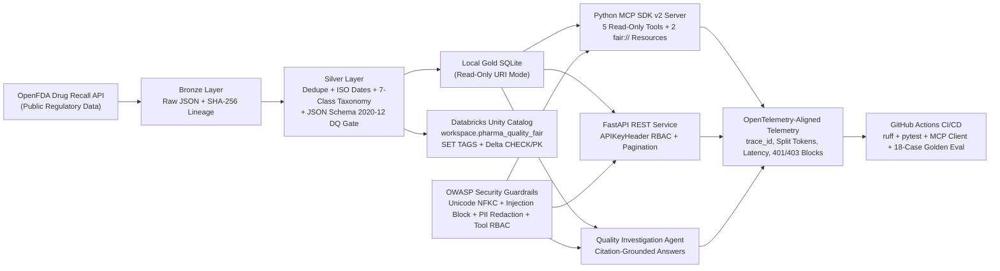

# Pharma Quality Intelligence Hub

[](https://github.com/Padwalpankaj9/pharma-quality-intelligence-hub/actions/workflows/ci.yml)


A production-style **FAIR Pharma Quality Data Product**, **Custom Python MCP v2 Server**, **RBAC-Gated FastAPI Service**, and **Evaluated Quality Investigation Agent** built over live FDA Drug Enforcement (Recall) data and governed in **Databricks Unity Catalog**.

> **Problem solved:** Pharmaceutical Quality teams often struggle with fragmented regulatory/recall feeds and ungoverned AI prototypes that lack lineage, access control, or measurable accuracy. This repository demonstrates a complete, testable pattern: contract-validated FAIR data in Unity Catalog, read-only MCP v2 and REST interfaces, OWASP-aligned AI security guardrails, OpenTelemetry GenAI-aligned telemetry, and CI-gated golden evaluations.

---

## Verified System Metrics (Latest Run)

| Capability | Verified Result | Source |
| --- | --- | --- |
| **Live OpenFDA Ingestion & DQ Gate** | **249 recalls across 75 firms**, 0 JSON Schema 2020-12 errors, 0% invalid dates | `pharma-qih-pipeline` |
| **Databricks Unity Catalog Governance** | **100 recalls across 26 firms** live in `workspace.pharma_quality_fair` with `SET TAGS` + Delta `NOT NULL` / `PK` / `CHECK` | `databricks/deploy_to_databricks.py` |
| **MCP v2 Protocol & FastAPI RBAC** | **5 read-only MCP tools** (`ToolAnnotations`, Pydantic schemas) + **2 `fair://` resources** + `APIKeyHeader` RBAC | `tests/test_hub.py` (5/5 passed) |
| **Golden Accuracy & Security Suite** | **100% tool accuracy**, **100% citation faithfulness**, **100% security recall**, **0% guardrail FPR**, **0 RBAC leaks** (18/18 cases) | `pharma-qih-eval` |
| **GitHub Actions CI/CD** | Green on `main` (`ruff`, offline pipeline, `pytest` + MCP `Client`, golden evals, artifact upload) | `.github/workflows/ci.yml` |

---

## 1. System Architecture



---

## 2. Example Output (Agent + Security Guardrails)

**Governed Quality query (`POST /v1/agent/ask` as `quality_analyst`):**
```json
{
  "status": "ok",
  "tools_used": ["get_firm_risk_summary"],
  "citations": ["firm:Apex Sterile Labs LLC", "firm:Midwest Pharma Corp"],
  "answer": "Apex Sterile Labs LLC: risk score 12 (3 recalls, 2 Class I, top cause: Sterility & Contamination)..."
}
```

**Adversarial prompt injection or unauthorized role (`quality_viewer` requesting record-level recalls):**
```json
{
  "status": "blocked",
  "blocked_reason": "prompt_injection_detected",
  "tools_used": [],
  "citations": [],
  "answer": "Request blocked by AI security guardrails."
}
```

---

## 3. Repository Structure

| Path | Responsibility |
| --- | --- |
| `metadata/data_contract.json` | Machine-readable JSON Schema 2020-12 contract, dataset PID (`urn:pharma-qih:dataset:gold_recalls:v1.0.0`), CC0-1.0/MIT license, ODCS SLA, and 21 CFR 7.3 reference. |
| `metadata/access_policy.yaml` | Role-based access control (RBAC) policy for `quality_viewer`, `quality_analyst`, and `data_steward` across REST endpoints and MCP tools. |
| `src/pharma_qih/pipeline/run_pipeline.py` | Bronze -> Silver -> Gold pipeline with runtime `jsonschema` validation, SHA-256 lineage, 7-class Pharma Quality taxonomy, and monthly Z-score anomaly detection. |
| `databricks/fair_openfda_pipeline.py` | Databricks PySpark + SQL medallion notebook with Unity Catalog `SET TAGS`, `NOT NULL`, `PRIMARY KEY`, and enforced Delta `CHECK` constraints. |
| `databricks/deploy_to_databricks.py` | Databricks CLI deployment script publishing live Gold Delta tables to `workspace.pharma_quality_fair`. |
| `src/pharma_qih/store.py` & `models.py` | Read-only SQLite URI (`?mode=ro`) queries with pagination and shared Pydantic v2 response models for FastAPI and MCP v2 `output_schema`. |
| `src/pharma_qih/mcp_server.py` | Custom Python MCP SDK v2 server (`MCPServer`) exposing 5 read-only tools (`ToolAnnotations`) and 2 `fair://` resources. |
| `src/pharma_qih/api.py` | Governed FastAPI service with `APIKeyHeader` OpenAPI auth, constant-time `hmac.compare_digest` verification, 401/403 audit logging, and HTTP 503 DB handling. |
| `src/pharma_qih/agent.py` & `security.py` | Citation-grounded Quality agent with OWASP LLM/Agentic guardrails (Unicode NFKC normalization, direct/indirect injection blocking, HTML/image sanitization, PII redaction, tool-level RBAC). |
| `src/pharma_qih/monitoring.py` | OpenTelemetry GenAI-aligned SQLite telemetry (`trace_id`, `gen_ai_operation_name`, split `input_tokens`/`output_tokens`, `error_type`, p95 latency). |
| `evals/golden_cases.json` & `eval_runner.py` | 18 stratified benchmark cases measuring tool accuracy, citation faithfulness, guardrail recall, guardrail FPR, and RBAC leak count. |
| `tests/test_hub.py` | `pytest` suite covering FAIR DQ contracts, security guardrails, FastAPI RBAC/OpenAPI/pagination, in-memory MCP v2 `Client` protocol tests, and golden evals. |
| `.github/workflows/ci.yml` | GitHub Actions CI gating every push on `ruff`, offline pipeline build, `pytest`, golden evals, and report artifact upload. |

---

## 4. Layer-by-Layer Design

### FAIR Data Product & Databricks Unity Catalog
- **Findable:** Registered in Databricks Unity Catalog (`workspace.pharma_quality_fair`) with searchable `ALTER SCHEMA/TABLE ... SET TAGS` (`data_product`, `domain`, `fair_compliant`, `medallion_layer`, `fair_owner`), persistent FDA `recall_number` primary keys, and dataset PID `urn:pharma-qih:dataset:gold_recalls:v1.0.0`.
- **Accessible:** Served through RBAC-gated FastAPI REST endpoints and read-only MCP v2 tools/resources.
- **Interoperable:** Enforces JSON Schema 2020-12, ISO-8601 dates, FDA 21 CFR 7.3 recall classes (`Class I/II/III`), and a standardized 7-class Pharma Quality taxonomy (`Sterility & Contamination`, `Impurity & Nitrosamine`, `Potency, Assay & Stability`, `CGMP Deviations`, `Foreign Matter & Particulate`, `Labeling & Packaging`, `Other Quality Defect`).
- **Reusable:** Runtime `jsonschema` contract validation gates Gold promotion; raw Bronze snapshots carry SHA-256 lineage checksums; explicit `CC0-1.0 / MIT` license metadata; enforced Databricks Delta `NOT NULL` and `CHECK` constraints (`valid_classification`, `valid_source_sha256`).
- **Analytics:** Computes firm-level severity-weighted risk scores (`Class I = 5`, `Class II = 2`, `Class III = 1`) and monthly Z-score recall anomalies (`z_score >= 1.5`).

### Custom Python MCP v2 Server & Governed FastAPI
- **MCP v2 Server (`pharma-qih-mcp`):** Built on `mcp.server.mcpserver.MCPServer` (SDK v2.3) with `ToolAnnotations(read_only_hint=True, open_world_hint=False)` and typed Pydantic outputs:
  - Tools: `search_recalls`, `get_firm_risk_summary`, `get_root_cause_trends`, `get_monthly_anomalies`, `get_fair_metadata`.
  - Resources: `fair://metadata` (live lineage & DQ status) and `fair://policy` (RBAC policy YAML).
- **FastAPI REST API (`pharma-qih-api`):** Uses `APIKeyHeader(name="X-API-Key")` for OpenAPI Swagger UI authorization and constant-time `hmac.compare_digest` verification:
  - `quality_viewer`: `/health`, `/v1/metadata`, `/v1/trends/root-causes`, `/v1/anomalies`.
  - `quality_analyst`: adds `/v1/recalls`, `/v1/firms/risk`, `/v1/agent/ask`, `/v1/monitoring/summary`.
  - `data_steward`: full read/audit access (`*`).

### OWASP AI Security, Telemetry & Golden Evals
- **OWASP LLM 2025 & Agentic 2026 Alignment:** Defends against direct/indirect prompt injection (`LLM01` / `ASI01`), sensitive data disclosure (`LLM02`), improper output handling (`LLM05`), and excessive agency / privilege abuse (`LLM06` / `ASI03`).
- **OpenTelemetry GenAI-Aligned Monitoring:** Records `trace_id`, `gen_ai_operation_name`, `gen_ai_agent_name`, split `input_tokens`/`output_tokens`, `tool_call_count`, `citation_count`, `error_type`, and 401/403 auth denials.
- **Stratified 18-Case Eval Suite:** Verifies **0% guardrail false-positive rate** on benign pharma queries containing SQL/security words (`"drop in potency"`, `"union of trends"`), **0 RBAC leaks**, and **100% citation faithfulness**.

---

## 5. Quickstart

```bash
# Install dependencies (Python 3.13 + uv)
uv sync --python 3.13 --extra dev

# 1. Run live OpenFDA Bronze -> Silver -> Gold pipeline (or pass --offline)
uv run pharma-qih-pipeline --limit 250

# 2. Run linter, unit/API/MCP v2 protocol tests, and 18-case golden evals
uv run ruff check src tests
uv run pytest -v
uv run pharma-qih-eval

# 3. Start local FastAPI service (Swagger UI at http://127.0.0.1:8000/docs)
uv run pharma-qih-api

# 4. Run MCP v2 stdio server
PHARMA_QIH_MCP_ROLE=quality_analyst uv run pharma-qih-mcp

# 5. Deploy live Gold Delta tables to Databricks Unity Catalog
databricks auth login --profile free
uv run python databricks/deploy_to_databricks.py
```

---

## 6. Architecture Decision Records (ADRs)

- **Dual Storage (Read-Only SQLite + Databricks Unity Catalog):** Read-only SQLite URI (`?mode=ro`) keeps `pytest`, MCP protocol tests, and GitHub Actions CI sub-second and deterministic without cloud credentials, while Unity Catalog (`workspace.pharma_quality_fair`) enforces Delta constraints and enterprise governance in the cloud.
- **Unity Catalog `SET TAGS` Alongside `TBLPROPERTIES`:** `TBLPROPERTIES` stores Delta/contract metadata, while Unity Catalog `SET TAGS` enables Workspace Search, schema-to-table inheritance, and attribute-based access control.
- **Tool-Layer RBAC (Defense in Depth):** Enforcing `is_mcp_tool_allowed(role, tool_name)` inside both the agent and MCP server ensures least privilege even when tools are called over stdio MCP rather than HTTP.
- **Measuring Guardrail False-Positive Rate (FPR):** Evaluating benign domain queries (`"drop in potency"`, `"union of trends"`) alongside adversarial injections prevents overly broad regexes from breaking real scientific workflows.
- **In-Memory MCP v2 Protocol Testing:** Using `mcp.Client(mcp_server.mcp)` inside `pytest` verifies real protocol framing (`list_tools` annotations/schemas, `call_tool` `structured_content`, RBAC denial, and `read_resource`) rather than calling plain Python functions.
