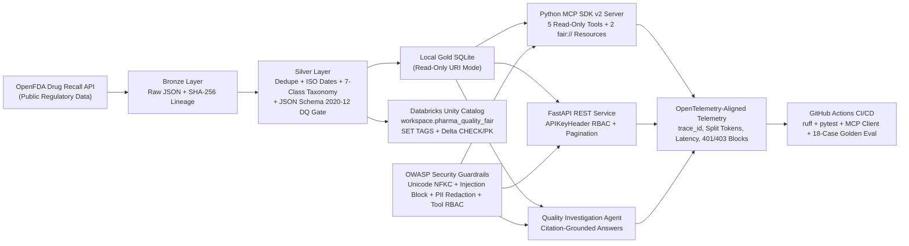

# Pharma Quality Intelligence Hub

[](https://github.com/Padwalpankaj9/pharma-quality-intelligence-hub/actions/workflows/ci.yml)

An end-to-end **FAIR Pharma Quality Data Product**, **Custom Python MCP v2 Server**, **RBAC-Gated FastAPI Service**, and **Evaluated Quality Investigation Agent** built on live public FDA Drug Enforcement (Recall) data and deployed to **Databricks Unity Catalog**.

---

## 1. High-Level Architecture



---

## 2. Repository Map

| Path | What it does |
| --- | --- |
| `metadata/data_contract.json` | Machine-readable JSON Schema 2020-12 contract, dataset PID (`urn:pharma-qih:dataset:gold_recalls:v1.0.0`), CC0-1.0/MIT license, ODCS SLA, and 21 CFR 7.3 reference. |
| `metadata/access_policy.yaml` | Role-based access control (RBAC) matrix for `quality_viewer`, `quality_analyst`, and `data_steward` across REST endpoints and MCP tools. |
| `src/pharma_qih/pipeline/run_pipeline.py` | Bronze -> Silver -> Gold pipeline with runtime `jsonschema` contract validation, SHA-256 checksums, 7-category Pharma Quality taxonomy, and monthly Z-score anomaly detection. |
| `databricks/fair_openfda_pipeline.py` | Databricks PySpark + SQL medallion notebook with Unity Catalog `SET TAGS`, `NOT NULL`, `PRIMARY KEY`, and enforced Delta `CHECK` constraints. |
| `databricks/deploy_to_databricks.py` | CLI deployment script that uploads the notebook and publishes live Gold Delta tables to `workspace.pharma_quality_fair`. |
| `src/pharma_qih/store.py` | Read-only SQLite URI (`?mode=ro`) query layer with parameterized SQL and `limit`/`offset` pagination. |
| `src/pharma_qih/models.py` | Shared Pydantic v2 response models powering both FastAPI `response_model` and MCP v2 `output_schema` / `structured_content`. |
| `src/pharma_qih/mcp_server.py` | Custom Python MCP SDK v2 server (`MCPServer`) exposing 5 read-only tools (`ToolAnnotations`) and 2 `fair://` resources. |
| `src/pharma_qih/api.py` | Governed FastAPI service with `APIKeyHeader` OpenAPI auth, RBAC enforcement, 401/403 audit logging, and HTTP 503 DB fault handling. |
| `src/pharma_qih/agent.py` | Citation-grounded Quality investigation agent enforcing tool-level RBAC (OWASP ASI03) and sanitizing retrieved FDA text. |
| `src/pharma_qih/security.py` | Constant-time `hmac.compare_digest` key check, Unicode NFKC normalization, direct/indirect prompt-injection and SQLi blocking, HTML/image sanitization, and PII/token redaction. |
| `src/pharma_qih/monitoring.py` | OpenTelemetry GenAI-aligned SQLite telemetry (`trace_id`, `gen_ai_operation_name`, split `input_tokens`/`output_tokens`, `error_type`, p95 latency). |
| `evals/golden_cases.json` | 18 stratified benchmark cases: 8 accuracy + exact citations, 2 benign-tricky guardrail FPR tests, 1 zero-match case, 2 cross-role RBAC denials, 5 direct + Unicode-obfuscated attacks. |
| `src/pharma_qih/eval_runner.py` | Computes `tool_selection_accuracy`, `citation_recall`, `citation_faithfulness`, `guardrail_recall`, `guardrail_fpr`, and `rbac_leak_count`. |
| `tests/test_hub.py` | `pytest` suite covering FAIR DQ contracts, security guardrails, FastAPI RBAC/OpenAPI/pagination, in-memory MCP v2 `Client` protocol tests, and golden evals. |
| `.github/workflows/ci.yml` | GitHub Actions CI gating every push on `ruff`, offline pipeline build, `pytest`, golden evals, and report artifact upload. |
| `docs/architecture.html` | Visual single-page architecture overview. |

---

## 3. Layer-by-Layer Deep Dive

### Layer 1: FAIR Data Product & Databricks Unity Catalog
- **Findable:** Registered in Databricks Unity Catalog (`workspace.pharma_quality_fair`) with searchable `ALTER SCHEMA/TABLE ... SET TAGS` (`data_product`, `domain`, `fair_compliant`, `medallion_layer`, `fair_owner`), persistent FDA `recall_number` primary keys, and dataset PID `urn:pharma-qih:dataset:gold_recalls:v1.0.0`.
- **Accessible:** Served through RBAC-gated FastAPI REST endpoints and read-only MCP v2 tools/resources.
- **Interoperable:** Enforces JSON Schema 2020-12, ISO-8601 dates, FDA 21 CFR 7.3 recall classes (`Class I/II/III`), and a standardized 7-class Pharma Quality root-cause taxonomy (`Sterility & Contamination`, `Impurity & Nitrosamine`, `Potency, Assay & Stability`, `CGMP Deviations`, `Foreign Matter & Particulate`, `Labeling & Packaging`, `Other Quality Defect`).
- **Reusable:** Runtime `jsonschema` validation gates Gold promotion; raw Bronze snapshots carry SHA-256 lineage checksums; explicit `CC0-1.0 / MIT` license metadata; enforced Databricks Delta `NOT NULL` and `CHECK` constraints (`valid_classification`, `valid_source_sha256`).
- **Analytics:** Computes firm-level severity-weighted risk scores (`Class I = 5`, `Class II = 2`, `Class III = 1`) and monthly Z-score recall anomalies (`z_score >= 1.5`).

### Layer 2: Custom Python MCP v2 Server & FastAPI REST API
- **MCP v2 Server (`pharma-qih-mcp`):** Uses `mcp.server.mcpserver.MCPServer` (SDK v2.3) with `ToolAnnotations(read_only_hint=True, open_world_hint=False)` and typed Pydantic outputs:
  - Tools: `search_recalls`, `get_firm_risk_summary`, `get_root_cause_trends`, `get_monthly_anomalies`, `get_fair_metadata`.
  - Resources: `fair://metadata` (live lineage & DQ status) and `fair://policy` (RBAC policy YAML).
  - Enforces role-level tool permissions (`PHARMA_QIH_MCP_ROLE`) and input/output guardrails on every call.
- **FastAPI REST API (`pharma-qih-api`):** Uses `APIKeyHeader(name="X-API-Key")` so Swagger UI (`/docs`) displays the Authorize flow. Keys are verified with `hmac.compare_digest`.
  - `quality_viewer` (`dev-viewer-key`): `/health`, `/v1/metadata`, `/v1/trends/root-causes`, `/v1/anomalies`.
  - `quality_analyst` (`dev-analyst-key`): adds `/v1/recalls`, `/v1/firms/risk`, `/v1/agent/ask`, `/v1/monitoring/summary`.
  - `data_steward` (`dev-steward-key`): full read/audit access (`*`).

### Layer 3: OWASP AI Security, Telemetry & 18-Case Golden Evals
- **OWASP LLM 2025 & Agentic 2026 Controls:**
  - *LLM01 / ASI01 (Direct & Indirect Prompt Injection):* Normalizes Unicode (`NFKC`) and strips zero-width characters before blocking override attempts; sanitizes retrieved FDA text to neutralize embedded instructions, `<script>` tags, and markdown image exfiltration (``).
  - *LLM02 (Sensitive Data Disclosure):* Redacts emails, SSNs, and API tokens from outputs.
  - *LLM06 / ASI03 (Excessive Agency & Privilege Abuse):* Read-only SQLite URI mode plus explicit `is_mcp_tool_allowed(role, tool_name)` enforcement inside both the agent and MCP server.
- **OpenTelemetry-Aligned Monitoring:** Logs `run_id`, `trace_id`, `gen_ai_operation_name`, `gen_ai_agent_name`, `latency_ms`, `status`, `blocked_reason`, `error_type`, `tool_call_count`, `citation_count`, `input_tokens`, and `output_tokens` to SQLite (including 401/403 API auth denials).
- **Golden Eval Benchmark (`pharma-qih-eval`):** Verified at **100% tool selection**, **100% accuracy**, **100% citation faithfulness**, **100% security recall**, **0% guardrail false-positive rate** (on tricky pharma queries like `"drop in potency"` and `"union of trends"`), and **0 RBAC leaks**.

---

## 4. Quickstart & Commands

### Local setup and verification
```bash
# Install dependencies (Python 3.13 + uv)
uv sync --python 3.13 --extra dev

# 1. Run live OpenFDA Bronze -> Silver -> Gold pipeline (or add --offline)
uv run pharma-qih-pipeline --limit 250

# 2. Run linter, unit/API/MCP v2 protocol tests, and 18-case golden evals
uv run ruff check src tests
uv run pytest -v
uv run pharma-qih-eval
```

### Run the REST API and test with curl
```bash
# Start FastAPI server at http://127.0.0.1:8000 (Swagger docs at /docs)
uv run pharma-qih-api

# Example calls (in another terminal)
curl -H "X-API-Key: dev-analyst-key" "http://127.0.0.1:8000/v1/recalls?classification=Class%20I&limit=5"
curl -X POST -H "X-API-Key: dev-analyst-key" -H "Content-Type: application/json" \
  -d '{"question": "Which recalling firms have the highest risk score?"}' \
  http://127.0.0.1:8000/v1/agent/ask
```

### Run the MCP v2 server (stdio)
```bash
PHARMA_QIH_MCP_ROLE=quality_analyst uv run pharma-qih-mcp
```

### Deploy to Databricks Unity Catalog
```bash
databricks auth login --profile free
uv run python databricks/deploy_to_databricks.py
```

---

## 5. Personal Review & Interview Q&A Cheat Sheet

1. **Why use both local SQLite and Databricks Unity Catalog?**
   Local read-only SQLite (`?mode=ro`) keeps `pytest`, MCP protocol tests, and GitHub Actions CI sub-second and deterministic without cloud credentials, while Databricks Unity Catalog (`workspace.pharma_quality_fair`) proves live Delta governance (`SET TAGS`, `NOT NULL`, `PRIMARY KEY`, and `CHECK` constraints).
2. **Why add Unity Catalog `SET TAGS` when you already had `TBLPROPERTIES`?**
   In Databricks, `TBLPROPERTIES` stores Delta/custom key-value metadata, whereas Unity Catalog `SET TAGS` powers Workspace Search, schema-to-table inheritance, and attribute-based access control (FAIR Findable + Accessible).
3. **Why test Guardrail False Positive Rate (FPR) alongside security recall?**
   A naive regex filter that blocks words like `"drop"` or `"union"` breaks legitimate pharma queries (`"drop in potency"`, `"union of trends"`). Tracking both 100% security recall and 0% FPR proves production-safe guardrails.
4. **Why enforce RBAC inside the agent and MCP server if FastAPI already checks API keys?**
   Per OWASP Agentic Top 10 (ASI03), API-edge auth is not enough when agents invoke tools directly or over stdio MCP. Enforcing `is_mcp_tool_allowed(role, tool_name)` at the tool layer guarantees least privilege everywhere.
5. **How do you test the MCP server beyond calling Python functions directly?**
   `tests/test_hub.py` uses MCP SDK v2's in-memory `Client(mcp_server.mcp)` to verify actual protocol framing: `list_tools()` annotations and output schemas, `call_tool()` `structured_content`, RBAC denial, and `read_resource("fair://metadata")`.
6. **What real bug did your golden eval suite catch during development?**
   The `ZERO-01` test (`"Show Class III nitrosamine recalls"`) caught a substring ordering bug where `"class ii"` matched inside `"class iii"` before `"class iii"` was checked. Reordering the classification checks fixed it immediately.
